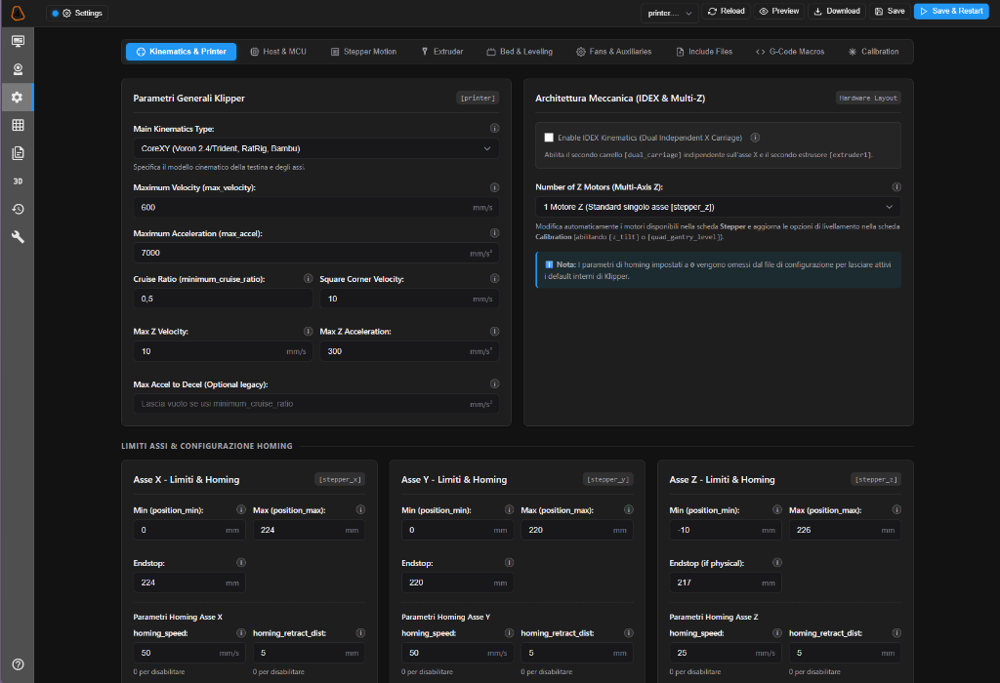

# 🎛️ Klipper Configurator for Mainsail WebUI

A modern, visual configuration module for the **Mainsail** WebUI, designed to provide a guided configuration experience for Klipper (`printer.cfg` or included `.cfg` files) through an intuitive interface packed with tabs, forms, toggle switches, and smart dropdowns.

It installs with a single command and adds a dedicated navigation entry (**Klipper Config**) directly into Mainsail's sidebar using the native navigation system (`.theme/navi.json`).

---

<p align="center">
  
</p>

---

## 📸 Key Features

- **Native Mainsail Integration**: Seamlessly embeds into Mainsail's sidebar with a dedicated configuration icon and full theme/color synchronization.
- **Mainsail Theme & Palette Sync**: Automatically matches Mainsail's active theme (Dark/Light mode) and primary accent color (Cyan, Voron Red, VzBot Cyan, RatRig Green, Klipper Orange, etc.) in real time.
- **Multilingual Support (Automatic Mainsail Locale Sync)**: Automatically detects Mainsail's configured language (English, Italian, German, French, Spanish) and translates the UI instantly.
- **Interactive Parameter Tooltips ("i" badge)**: Informative circle icon next to every parameter providing official Klipper directives, units of measurement, detailed explanations, and recommended values.
- **Real-Time Unsaved Changes Tracking**: Visual amber highlighting and a status bar pill counter for modified parameters before saving.
- **Mobile-Optimized Compact Mode**: Responsive UI that automatically transforms topbar action buttons and section tabs into clean, space-saving SVG icons on smartphone displays (`<= 768px`).
- **Responsive `.cfg` File Selector**: Dynamically sizes itself to fit the selected file name without wasting navbar space or cutting off filenames.

### 8 Dedicated Configuration Categories:

1. **Kinematics & Printer**:
   - General printer parameters (`[printer]`): kinematics type (`cartesian`, `corexy`, `corexz`, `delta`, `hybrid_corexy`, etc.), maximum velocity, maximum acceleration, `minimum_cruise_ratio`, `square_corner_velocity`, and Z-axis dynamics (`max_z_velocity`, `max_z_accel`).
   - **IDEX (Independent Dual Extruder) Support**: Toggle to enable the secondary independent carriage (`[dual_carriage]`) and second extruder (`[extruder1]`).
   - **Multi-Z Axis Configuration**: Select the number of Z motors (1 standard, 2 Dual-Z, 3 Triple-Z e.g., Trident, 4 Quad-Z e.g., Voron 2.4) with automatic synchronization of stepper driver sections and calibration leveling (`[z_tilt]` or `[quad_gantry_level]`).
   - **Advanced Axis Limits & Homing Settings (X, Dual Carriage X2, Y, Z)**:
     - `position_min`, `position_max`, `position_endstop`.
     - Dedicated homing parameters: `homing_speed`, `homing_retract_dist`, and `homing_retract_speed` (set to `0` to disable/omit from config).

2. **Host / MCU**:
   - Connection types: USB Serial, CAN Bus (`canbus_uuid`), or UART; baud rate; secondary MCU toolhead boards (e.g., EBB36, SB2209); Host CPU (`raspberry_pi`) and MCU temperature monitoring.

3. **Stepper Motion & Drivers (Adaptive to IDEX & Multi-Z)**:
   - Dynamic axis management: X Axis, Dual Carriage X2 (if IDEX is enabled), Y Axis, Z Axis, and auxiliary motors Z1, Z2, Z3 (based on Multi-Z count).
   - Control pins (step, dir, enable with `!` inversion), microstepping (16, 32, 64, 128, 256), built-in `rotation_distance` calculator, physical endstops, or **Sensorless Homing** (StallGuard / SGTHRS).
   - Smart TMC drivers (`tmc2209`, `tmc2208`, `tmc2226`, `tmc5160`, `tmc2240`): Standalone, UART, or SPI connection modes; RMS run current (`run_current`), optional `hold_current`, custom `sense_resistor`, and StealthChop.

4. **Extruder (IDEX Extruder 0 & Extruder 1 Support)**:
   - Extruder selector: `[extruder]` and `[extruder1]` (when IDEX is active).
   - Nozzle and filament diameter, Pressure Advance, full thermistor selection (EPCOS 100K, Generic 3950, ATC Semitec, PT1000, etc.), heater pins, and PID or Watermark thermal control.
   - **SPI / RTD Temperature Sensors**: Support for MAX31865, MAX6675, MAX31855 with hardware/software SPI bus, RTD nominal and reference resistances, and 2/3/4-wire modes.

5. **Heated Bed**:
   - Bed temperature sensor, heater pin, min/max limits, and thermal control algorithm (PID with Kp/Ki/Kd or Watermark with `max_delta`).

6. **Misceleus (Fans, Accelerometer, LEDs)**:
   - Part cooling (`[fan]`), hotend heatsink (`[heater_fan]`), and auxiliary fans (`[fan_generic]`, `[controller_fan]`, `[temperature_fan]`).
   - ADXL345 accelerometer on SPI bus with axis mapping (`axes_map`) and data rate.
   - LED lighting (Neopixel WS2812B, DotStar, PWM).
   - Core Klipper helper modules (`[virtual_sdcard]`, `[pause_resume]`, `[display_status]`, `[respond]`) and `idle_timeout`.

7. **Include Files**:
   - Visual management of external file inclusions (`[include filename.cfg]`) with quick-insert presets for popular modular setups (`macros.cfg`, `steppers.cfg`, `fans.cfg`, `canbus.cfg`, `ebb36.cfg`, `sensorless.cfg`).

8. **Calibration**:
   - Probe or BLTouch/CR Touch configuration (X, Y, Z offsets, pin, samples).
   - Safe Z Homing (`[safe_z_home]`), Bed Mesh leveling grid (`[bed_mesh]`), Resonance Tester & Input Shaper (`[resonance_tester]`, `[input_shaper]`).
   - **Dynamic Multi-Z Leveling**:
     - 2 or 3 Z motors: automatic `[z_tilt]` alignment (Z-Tilt Leveling with z_positions and probe points).
     - 4 Z motors: automatic `[quad_gantry_level]` alignment (QGL with gantry_corners and probe points).

---

## 🛡️ Total Configuration Safety

- **Automatic Backups**: Prior to saving changes via Moonraker, a timestamped backup copy is automatically created (e.g., `printer.cfg.bak.20261013180000`).
- **SAVE_CONFIG Block Preservation**: The automatic section generated by Klipper for PID tunes, Z-offsets, and bed meshes (`#*# <---------------------- SAVE_CONFIG ---------------------->`) is 100% preserved.
- **CFG Preview & Diff**: Inspect the generated code before committing any changes with a single click.
- **Save & Firmware Restart**: Save configurations and immediately trigger a `FIRMWARE_RESTART` with one click.

---

## 🚀 Quick Installation (Raspberry Pi / MainsailOS)

Connect to your printer host via SSH and run:

```bash
cd ~
git clone https://github.com/sedimenti-hub/KlifigUI.git
cd KlifigUI
chmod +x install.sh
./install.sh
```

The automated installer will:
1. Locate your Klipper configuration directory (`~/printer_data/config`).
2. Deploy the web interface files to `/var/www/klipper-configurator`.
3. Configure Nginx by routing `/configurator`.
4. Register the new **Klipper Config** item in Mainsail's `.theme/navi.json`.

Once installed, open Mainsail in your browser and press **CTRL + F5**: the new configuration tab will appear in your sidebar!

---

## 🔄 Automatic Updates via Mainsail

You can update KlifigUI with 1 click directly from the Mainsail interface (**Machine -> Update Manager**).

Add the following block to the bottom of your `~/printer_data/config/moonraker.conf` file:

```ini
[update_manager KlifigUI]
type: git_repo
path: ~/KlifigUI
origin: https://github.com/sedimenti-hub/KlifigUI.git
primary_branch: main
is_system_service: False
```

---

## 🗑️ Uninstallation

To remove Klipper Configurator:

```bash
cd ~/KlifigUI
chmod +x uninstall.sh
./uninstall.sh
```
