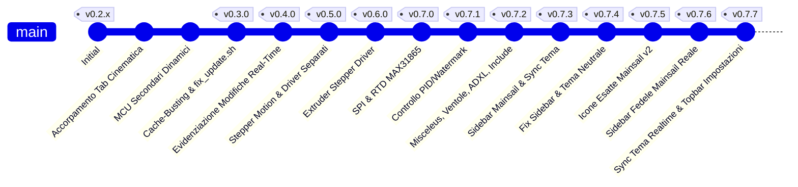

# 📋 Riepilogo Completo Progetto: Klipper Configurator (KlifigUI)

Questo documento raccoglie in maniera dettagliata l'intera cronologia delle richieste, l'evoluzione del codice, l'architettura dei moduli e tutte le versioni implementate dall'inizio della sessione fino alla versione corrente (**v0.7.5**).

---

## 🧭 Indice dei Contenuti
1. [Obiettivo Generale del Progetto](#1-obiettivo-generale-del-progetto)
2. [Cronologia delle Versioni e Richieste Utente](#2-cronologia-delle-versioni-e-richieste-utente)
3. [Dettaglio Tecnico delle Funzionalità Realizzate](#3-dettaglio-tecnico-delle-funzionalit-realizzate)
   - [Unificazione Cinematica e Layout Schede](#31-unificazione-cinematica-e-layout-schede)
   - [Gestione Cache-Busting e Script di Aggiornamento](#32-gestione-cache-busting-e-script-di-aggiornamento)
   - [Rilevamento e Segnalazione Modifiche in Tempo Reale](#33-rilevamento-e-segnalazione-modifiche-in-tempo-reale)
   - [Modulo "Stepper Motion" e Driver Avanzati](#34-modulo-stepper-motion-e-driver-avanzati)
   - [Modulo Extruder e Sensori Temperatura Avanzati (SPI / RTD)](#35-modulo-extruder-e-sensori-temperatura-avanzati-spi--rtd)
   - [Algoritmi Controllo Temperatura: PID vs Watermark](#36-algoritmi-controllo-temperatura-pid-vs-watermark)
   - [Sezione Misceleus (Ventole Multiple, ADXL345, LED)](#37-sezione-misceleus-ventole-multiple-adxl345-led)
   - [Nuovo Tab Include & Resonance Tester](#38-nuovo-tab-include--resonance-tester)
   - [Integrazione Fedele con Mainsail: Sidebar, Temi e Palette Colori](#39-integrazione-fedele-con-mainsail-sidebar-temi-e-palette-colori)
4. [Architettura del Repository e File Chiave](#4-architettura-del-repository-e-file-chiave)
5. [Stato Attuale e Prossimi Passi](#5-stato-attuale-e-prossimi-passi)

---

## 1. Obiettivo Generale del Progetto
**Klipper Configurator (KlifigUI)** nasce con lo scopo di fornire un'interfaccia web moderna, pulita, intuitiva e nativamente integrata con **Mainsail** e **Moonraker** per visualizzare, modificare, calibrare e validare l'intera configurazione di stampanti 3D basate su **Klipper** (`printer.cfg` e file inclusi).

### Punti Chiave dell'Esperienza Utente:
- **Nessuna perdita di configurazione**: backup automatici ad ogni salvataggio.
- **Supporto multi-hardware**: CoreXY, Cartesian, Delta, Rotational, IDEX (Dual Carriage), Multi-Z (Z, Z1, Z2, Z3), MCU secondari multipli (CAN Bus, toolhead board come EBB36, Raspberry Pi).
- **Controllo visivo delle modifiche**: feedback immediato prima di salvare o riavviare il firmware.
- **Coerenza visiva assoluta**: rispetto dello stile grafico, della sidebar laterale e della palette cromatica impostata dall'utente in Mainsail.

---

## 2. Cronologia delle Versioni e Richieste Utente



### Tabella Sintetica delle Versioni e Richieste

| Versione | Richiesta Utente Principale | Modifiche Chiave Implementate |
| :--- | :--- | :--- |
| **v0.3.0** | *"le modifiche faticano ad aggiornarsi ogni volta"* | Parametri cache-busting `?v=X` su CSS e JS; script `fix_update.sh`; configurazione `core.fileMode false` per evitare lock DIRTY in Moonraker; introdotto badge versione. |
| **v0.4.0** | *"Ogni volta che l'utente apporta modifiche prima del salvataggio, evidenzia i settaggi modificati"* | Sistema di baseline snapshot in tempo reale; highlight arancione sui campi modificati; pill contatore `X modifiche non salvate` nella barra di stato. |
| **v0.5.0** | *"Rinomina Stepper driver in Stepper Motion; aggiungi tipo connessione driver (standalone, UART, SPI); aggiungi hold_current e sense_resistor"* | Ridenominazione tab; disaccoppiamento tipo driver da tipo connessione; form condizionali per pin UART / SPI / Standalone; checkbox + campi per `hold_current` e `sense_resistor`. |
| **v0.6.0** | *"Nella sezione Extruder aggiungere i settaggi riguardante i driver come in stepper motion"* | Estensione della logica driver anche alla scheda estrusore (scelta TMC2209, Standalone/UART/SPI, resistore di sensing, corrente di stasi). |
| **v0.7.0** | *"Sensore temperatura extruder con controller SPI (es. MAX31865): inserire SPEED, BUS e RTD"* | Form dedicato per sensori PT100/PT1000 con MAX31865/MAX6675/MAX31855: pin CS, velocità bus SPI, `spi_bus` o software SPI, parametri RTD (`nominal_r`, `reference_r`, filtri). |
| **v0.7.1** | *"Elimina scritta 'modificato' (mantieni dot); aggiungi scelta controllo temperatura PID vs watermark; incrementa solo l'ultima cifra"* | Eliminata etichetta testuale mantenendo solo il segnalatore a dot; aggiunto selettore per controllo temperatura (`watermark` con `max_delta` vs `pid` con `Kp/Ki/Kd`) per estrusore e piatto riscaldato; regola di versioning rigorosa (`0.7.X`). |
| **v0.7.2** | *"Ventole aggiuntive con tipologia Klipper; pin ADXL345; sezione LED; Tab Include; resonance_tester nel box calibrazione"* | Gestione dinamica ventole (`fan`, `heater_fan`, `fan_generic`, `controller_fan`, `temperature_fan`); gestione ADXL345 su SPI; LED Neopixel/Dotstar/PWM; nuovo Tab 6 "Include" con preset veloci; accorpamento `resonance_tester` con Z-offset e input shape. |
| **v0.7.3** | *"Rendi la sezione klipper config sensibile al tema e colori di Mainsail; aggiungi la sidebar di Mainsail"* | Inserimento della barra laterale a scomparsa con link alle sezioni di Mainsail; query a Moonraker per leggere `uiSettings` e applicare colore primario e tema dark/light. |
| **v0.7.4** | *"Il tema non è uguale a Mainsail; la barra laterale è rotta e elementi non allineati"* | Riconversione colori al Dark Charcoal originale Mainsail (`#121212`, `#1e1e1e`, `#00c0f3`); correzione flexbox sidebar (icone non più tagliate quando compressa); griglie bilanciate per Cinematica e Assi XYZ; aggiunta color picker nativo e preset vendor. |
| **v0.7.5** | *"Allineamento perfetto icone e navigazione"* | Adozione delle icone SVG Material Design ufficiali di Mainsail v2 (Webcam, Controllo Movimento, Heightmap, File, Visualizzatore 3D, Cronologia, Macchina, Impostazioni, Configurator); chevron collassa/espandi. |
| **v0.7.6** | *"Rendi la sidebar di klipper config uguale a quella di mainsails recuperando stile, icone e posizionamento"* | Sidebar clonata da `TheSidebar.vue`/`SidebarItem.vue`: colore sfondo grigio `#4f4f4f` identico a Mainsail; icone MDI ufficiali (Dashboard, Webcam, Console `mdiConsoleLine`, Heightmap, File G-Code, 3D Viewer, History, Timelapse, Machine); posizionamento e visibilità dinamici recuperati da Moonraker (`/server/info`, webcams, configfile settings, `.theme/navi.json` e `gui.navigation.entries`); indicatore attivo bordo destro 4px color primario; logo Mainsail ufficiale topbar. |
| **v0.7.7** | *"Tema applicato in automatico come Mainsail in tempo reale; elimina Moonraker connesso e versione dalla navbar e spostali in Impostazioni"* | Sincronizzazione automatica tema Mainsail in tempo reale via WebSocket, polling continuo e focus window; riorganizzazione completa topbar (eliminato bottone "Moonraker Connesso" e badge versione); nuovo tasto "Impostazioni" (ex "Tema"); lo stato di connessione con led e il badge versione sono integrati direttamente nel modale Impostazioni. |

---

## 3. Dettaglio Tecnico delle Funzionalità Realizzate

### 3.1. Unificazione Cinematica e Layout Schede
- È stata accorpata la configurazione generale della stampante `[printer]` (velocità massima, accelerazioni massime, square corner velocity) con le geometrie cinematiche (`cartesian`, `corexy`, `delta`, `rotational_delta`, `winch`).
- Supporto nativo alle configurazioni avanzate:
  - **IDEX (Independent Dual Extruder)**: modulo per carrello `[dual_carriage]`.
  - **Multi-Asse Z**: supporto dinamico per 1, 2, 3 o 4 motori Z (`[stepper_z]`, `[stepper_z1]`, `[stepper_z2]`, `[stepper_z3]`), con adeguamento visivo delle card di calibrazione (`z_tilt` o `quad_gantry_level`).
  - **Microcontrollori secondari**: aggiunta dinamica di sezioni `[mcu nome_mcu]` con gestione seriale, CAN-bus (`canbus_uuid`) o baud rate personalizzato.

### 3.2. Gestione Cache-Busting e Script di Aggiornamento
Per risolvere il problema dei browser o di Moonraker che mantenevano versioni JavaScript/CSS obsolete:
1. **Cache-Busting String**: tutti i riferimenti negli `<script>` e `<link>` contengono `?v=X.X.X` aggiornato a ogni release.
2. **`scripts/fix_update.sh`**: script bash per Raspberry Pi / Moonraker che:
   - Configura `git config core.fileMode false` prevenendo modifiche fittizie ai permessi file.
   - Crea i collegamenti simbolici corretti per Nginx / Mainsail.
   - Permette l'aggiornamento pulito da Git senza generare conflitti `DIRTY`.

### 3.3. Rilevamento e Segnalazione Modifiche in Tempo Reale
- Al caricamento di un file `.cfg` viene scattata una fotografia istantanea (`baselineSnapshot`) di tutti i campi.
- In tempo reale, ad ogni evento `input` o `change`, il sistema confronta il valore attuale con la baseline:
  - Se modificato: il controllo riceve la classe `.is-modified` (bordo ambrato luminoso) e un piccolo indicatore (dot) a fianco.
  - Se ripristinato al valore originale: l'evidenziazione scompare automaticamente.
  - Nella top bar, la pill **Unsaved Changes** mostra dinamicamente il conteggio esatto delle impostazioni modificate (`es. "3 modifiche"`).

### 3.4. Modulo "Stepper Motion" e Driver Avanzati
- **Disaccoppiamento Chip / Protocollo**: separata la scelta del driver (TMC2209, TMC2208, TMC2240, TMC5160, TMC2130, A4988, DRV8825) dal metodo di comunicazione.
- **Tipologia di Connessione Dinamica**:
  - `Standalone`: mostra solo pin step, dir, enable e microstep hardware.
  - `UART`: mostra i form per `uart_pin`, `tx_pin` opzionale e `uart_address` (per driver multipli su singolo bus).
  - `SPI`: mostra selettore modalità SPI (Hardware Bus vs Software Bit-Banging), pin `cs_pin`, e campi per `spi_bus` oppure `spi_software_sclk_pin`, `spi_software_mosi_pin`, `spi_software_miso_pin`.
- **Parametri Elettrici Condizionali**:
  - `hold_current`: abilitabile con checkbox dedicata, con input corrente in Ampere.
  - `sense_resistor`: abilitabile con checkbox (es. 0.110 per TMC2209 standard, 0.075 per estrusori compatti, 0.022 per TMC5160 ad alto amperaggio).
- **Sensorless Homing Integrato**: soglia `driver_SGTHRS` o `driver_SGT` calcolata e guidata visivamente.

### 3.5. Modulo Extruder e Sensori Temperatura Avanzati (SPI / RTD)
- La scheda Extruder include gli stessi settaggi del motore passo-passo (corrente, microstepping, stealthchop, connessione UART/SPI).
- **Sensori Termocoppia / RTD su SPI**:
  - Selezione di sensori analogici convenzionali (`EPCOS 100K B57560G104F`, `ATC Semitec 104GT-2`, `Generic 3950`) oppure controller SPI dedicati (`MAX31865`, `MAX6675`, `MAX31855`).
  - Quando si seleziona un chip come il **MAX31865**:
    - Compaiono i parametri SPI (`spi_speed`, `spi_bus`, o pin SPI software).
    - Compaiono le impostazioni per sonde PT100/PT1000 (`rtd_nominal_r`, `rtd_reference_r`, collegamento a 2, 3 o 4 fili `rtd_num_of_wires`, filtro 50Hz/60Hz contro i disturbi di rete).

### 3.6. Algoritmi Controllo Temperatura: PID vs Watermark
Sia per l'**Estrusore** che per il **Piano Riscaldato (Heater Bed)** è disponibile la scelta dell'algoritmo di termoregolazione:
- `PID`: espone i parametri `pid_Kp`, `pid_Ki`, `pid_Kd` (con scorciatoia per autotune).
- `Watermark`: espone il parametro di isteresi `max_delta` (ideale per letti ad alta inerzia termica o riscaldatori a relè).

### 3.7. Sezione Misceleus (Ventole Multiple, ADXL345, LED)
- **Ventole Multiple**: aggiunta libera di ventole con supporto a tutte le macro e sezioni native Klipper:
  - `[fan]` (Ventola layer pezzo)
  - `[heater_fan]` (Ventola dissipatore hotend, con temperatura di attivazione)
  - `[fan_generic]` (Ventola ausiliaria controllabile da G-Code `M106`)
  - `[controller_fan]` (Ventola raffreddamento driver/scheda madre)
  - `[temperature_fan]` (Ventola termocontrollata con sensore associato)
- **Accelerometro ADXL345**:
  - Assegnazione pin CS, scelta bus SPI hardware o bit-banging software.
  - Selezione orientamento assi `axes_map` (es. `x,y,z`, `-x,z,y`, ecc.).
  - Frequenza di campionamento `rate` (da 1600Hz a 3200Hz).
- **LED & Illuminazione**:
  - Supporto per stringhe Neopixel (WS2812B), DotStar o pin PWM semplici.
  - Conteggio LED, pin dati, colori iniziali (Rosso, Verde, Blu, Bianco).

### 3.8. Nuovo Tab Include & Resonance Tester
- **Tab Include (File Esterni)**:
  - Permette di aggiungere e rimuovere righe `[include nome_file.cfg]`.
  - Include pulsanti rapidi con preset per configurazioni modulari popolari: `macros.cfg`, `steppers.cfg`, `fans.cfg`, `canbus.cfg`, `ebb36.cfg`, `sensorless.cfg`.
- **Unificazione Calibrazione**:
  - Il modulo `[resonance_tester]` (con scelta chip accelerometro, frequenze di sweep e punti di tastatura sul piano `probe_points`) è stato accorpato direttamente nel box di calibrazione con `[input_shaper]` e `probe:z_offset`.

### 3.9. Integrazione Fedele con Mainsail: Sidebar, Temi e Palette Colori
- **Sidebar Laterale Ufficiale**:
  - Larghezza standard Mainsail (56px collassata, espandibile a 240px tramite pulsante dedicato).
  - Voci e icone Material Design SVG identiche a Mainsail: *Dashboard, Webcam, Controllo/Movimento, Mappa Altezza, File G-Code, Visualizzatore 3D, Cronologia, Klipper Configurator (attivo), Macchina, Impostazioni*.
  - Tutte le voci puntano direttamente alle rispettive pagine di Mainsail (`/#/`, `/#/cam`, `/#/control`, `/#/heightmap`, `/#/files`, `/#/viewer`, `/#/history`, `/#/machine`, `/#/settings`).
  - Risolto il difetto di rendering: i label nascosti hanno `display: none !important`, mantenendo le icone perfettamente centrate nei loro box 56x46px.
- **Sincronizzazione Dinamica Tema da Moonraker**:
  - Interroga Moonraker via endpoint `/server/database/item?namespace=mainsail`.
  - Legge `uiSettings.primaryColor` o traduce i preset vendor ufficiali (`mainsail: #00c0f3`, `voron: #d32f2f`, `vzbot: #00e5ff`, `ratrig: #00ff41`, `klipper: #f97316`, `purple: #9333ea`, `blue: #0284c7`, `emerald: #10b981`).
  - Rileva e carica automaticamente loghi personalizzati (`.theme/sidebar-logo.svg` o `.png`) e stili custom (`.theme/custom.css`).
  - Pulsante rapido **"Tema"** nella barra superiore con indicatore del colore attivo e apertura di un color picker interattivo HTML5.

---

## 4. Architettura del Repository e File Chiave

```
KlipperUI / KlifigUI/
├── dist/
│   ├── index.html              # Markup principale con le 8 macro-schede e la sidebar Mainsail
│   ├── css/
│   │   └── style.css           # Variabili di tema Mainsail (#121212, #1e1e1e), layout griglie e sidebar
│   └── js/
│       ├── klipper-parser.js   # Parser e generatore bidirezionale formato INI Klipper
│       ├── default-config.js   # Valori di fallback e template di riferimento
│       ├── moonraker-client.js # Client HTTP/WebSocket per API Moonraker e DB Mainsail
│       ├── tooltips.js         # Modulo documentazione parametri, badge 'i' e tooltip fluttuante
│       └── app.js              # Controller applicativo, reattività DOM e sincronizzazione
├── scripts/
│   ├── install.sh              # Script di installazione automatica
│   └── fix_update.sh           # Script di correzione aggiornamenti e permessi Moonraker
└── README.md                   # Documentazione di progetto
```

---

## 5. Stato Attuale e Prossimi Passi

### Risultati Conseguiti:
- ✅ **Versione corrente**: `v0.7.9`.
- ✅ **Badge Informativo "i" e Tooltip Contestuali su Ogni Valore**:
  - Inserito un piccolo cerchietto con una "i" (`.info-circle`) accanto a ogni parametro, campo input, selettore e checkbox dell'applicazione.
  - Al passaggio del mouse (hover) viene visualizzato un tooltip fluttuante ricco (`#klifig-tooltip`) con posizionamento automatico intelligente sopra o sotto l'elemento e rilevamento dei bordi dello schermo (anti-collisione).
  - Ciascun tooltip mostra il nome esatto della direttiva Klipper (es. `[printer] max_velocity`, `rotation_distance`, `hold_current`, `sensor_type`), l'unità di misura (mm, mm/s, mm/s², Ampere, °C, Ω), la spiegazione chiara e completa del suo funzionamento e consigli sui valori tipici raccomandati.
  - Creato il modulo dedicato [`dist/js/tooltips.js`](file:///d:/Antigravity/KlifigUI/dist/js/tooltips.js) con dizionario esteso di parametri Klipper e iniezione dinamica automatica tramite `MutationObserver` per coprire anche schede e controlli aggiunti a runtime (ventole dinamiche, macro, include, motori multi-asse Z).
  - Pieno supporto touch per dispositivi mobili con apertura/chiusura al tocco.
- ✅ **Fix Apertura Popup Impostazioni & Layout Topbar Sinistra**:
  - Risolta la mancata apertura del modal impostazioni causata da un'uscita prematura in `initSidebar()` (dovuta a un selettore obsoleto della vecchia sidebar) e unificati i gestori di eventi per `#btn-settings`.
  - Spostato il pulsante **"Impostazioni"** all'estrema sinistra della barra di navigazione (`.nav-left`), garantendo un accesso immediato a configurazione connessione e tema.
  - Rimossi il logo "K" e la scritta testuale "Klipper Configurator" dalla barra superiore per un'interfaccia più pulita e coerente con la dashboard Mainsail.
- ✅ **Sincronizzazione Automatica Tema in Tempo Reale**:
  - Il tema e i colori di Klipper Configurator si sincronizzano automaticamente con Mainsail. Se l'utente cambia tema, colore primario o modalità (chiaro/scuro) su Mainsail, le modifiche si riflettono istantaneamente su KlifigUI via WebSocket Moonraker, polling ogni 10s e listener di focus sulla finestra.
  - Supportati tutti i temi e preset vendor di Mainsail (`mainsail: #2196f3`, `klipper: #f97316`, `voron: #d32f2f`, `vzbot: #00e5ff`, `ratrig: #00ff41`, `ldo`, `yumi`, `prusa`, `btt`, `multec`, ecc.).
- ✅ **Top Bar Riorganizzata & Sezione Impostazioni**:
  - Eliminato il pulsante pill "Moonraker connesso" dalla barra superiore.
  - Eliminato il tag/badge della versione dalla testata della barra superiore.
  - Rinominato il tasto "Tema" in **"Impostazioni"** con icona ingranaggio e dot cromatico attivo.
  - Lo stato di connessione a Moonraker (con led verde/rosso) e il badge della versione (`v0.7.9`) sono ora comodamente consultabili all'interno del modale **Impostazioni**.
- ✅ **Sidebar Mainsail Fedele al 100%**:
  - Colore di sfondo grigio `#4f4f4f` (`--sidebar-bg-color`) estratto direttamente dal tema attivo di Mainsail.
  - Voci e icone Material Design ufficiali (@mdi/js) allineate all'architettura Vue/Vuetify di Mainsail (`TheSidebar.vue`, `SidebarItem.vue`, `src/routes/index.ts`).
  - Posizioni e ordine esatti (Dashboard 10, Webcam 20, Console 30, Heightmap 40, G-Code Files 50, G-Code Viewer 60, History 70, Timelapse 80, Machine 90, più link personalizzati da `.theme/navi.json`).
  - Dinamicità Moonraker: interroga `/server/info` per stato Klippy e componenti, `/server/webcams/list` per webcam registrate, `/printer/objects/query?configfile=settings` per verificare la presenza di `bed_mesh`, e `navigation.entries` dal database Moonraker per rispettare l'ordine e la visibilità scelti dall'utente nelle impostazioni di Mainsail.
  - Indicatore pagina attiva fedele: `border-right: 4px solid var(--primary)` e sfondo overlay semitrasparente.
  - Tooltip laterale a destra (`v-tooltip right`) con ritardo di 500ms e icona info (`AboutDialog`) in fondo alla sidebar.
  - Logo Mainsail ufficiale in SVG (`MainsailLogo.vue`) nella testata della barra.
- ✅ **Cinematica e Assi**: schede riorganizzate con griglie simmetriche per asse X, Y e Z.
- ✅ **Connessioni Driver & Sensori**: supporto completo per UART, SPI hardware/software, RTD MAX31865, ventole multiple, LED e ADXL345.
- ✅ **Feedback visivo**: evidenziazione modifiche non salvate in tempo reale con dot discreto.

### Note di Sviluppo & Utilizzo:
- Nel caso in cui il push automatico da console verso GitHub incontri il blocco credenziali non interattivo di Windows, è sufficiente eseguire dal terminale locale dell'utente:
  ```powershell
  cd d:\Antigravity\KlifigUI
  git push origin main
  ```
  Tutti i commit fino a `v0.7.9` sono già stati generati e validati localmente.
